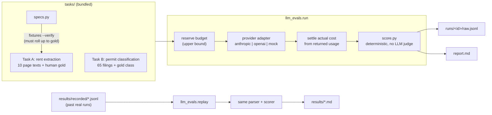

# llm-evals

Ranks LLM APIs on accuracy and cost over two real-estate data tasks: extracting rents from apartment floor-plan pages and classifying construction-permit filings by dwelling type.

**Live:** [hermanchan.ai/projects/evaluation-framework](https://www.hermanchan.ai/projects/evaluation-framework/)

## Why it exists

Rental underwriting leans on two kinds of LLM output: asking rents and availability scraped from operator websites, and a count of competing supply built from permit filings. A model that writes "0 available" where the page says nothing makes a property look sold out, and a model that calls a 200-unit apartment project "single family" removes it from the supply count. Choosing a cheaper model is only safe if you can measure those failures, and their cost, on cases where the right answer is known.

## Architecture



## Quickstart

Python 3.11+, standard library only (no install, no key, no network):

```bash
python -m llm_evals.fixtures --verify
python -m llm_evals.replay results/recorded/2026-09-18_luna-vs-haiku.jsonl
python -m llm_evals.run --models mock:oracle,mock:baseline --repetitions 1
```

The first proves every bundled page text rolls up to its gold label. The second re-scores the recorded outputs of a past paid run and prints the results table. The third runs the full reserve → call → settle → score path against the offline mock provider.

Live calls need `pip install -r requirements.txt`, a key in `.env` (see `.env.example`) and a daily ceiling you choose; see [docs/providers.md](docs/providers.md).

## The two tasks

**A: rent extraction.** Each case is the visible text of one community's floor-plans page. The model returns one JSON group per bedroom count: square-foot range, rent range, units available, units coming soon, plus a community-level free-rent concession in weeks. Ten cases, each built around a trap documented on a real site:

| case | what it tests |
|---|---|
| `avail_sandy_springs` | nothing: clean per-unit tables. A model that misses here is out. |
| `emblem_conyers` | a "6 weeks free" banner gated on touring a named bed type → concession is null |
| `union_landing` | plans published, none bookable → availability null (not 0) |
| `northbend` | "Contact Us" plans add 0 units and no rent; Live/Work plans stay out of the SF band |
| `aventerra_dobson_ranch` | no price anywhere, a 6-row display cap, a placeholder plan to drop |
| `smart_living_cypress_creek` | the page renders 10 rows but publishes "Showing 10 of 14" → 14 |
| `mural_at_stovehouse` | the site leads with base + fees; record base rent. "Up to three months free" → 12 |
| `the_kelvin` | each unit shows a lease-term price range → take the low end |
| `gateway_village_swan_creek` | plan badges undercount the unit tables; a starting-price promo is not a concession |
| `huntcliff` | an affordable-program bucket spanning an SF range stays out of the 1BR band |

**B: permit classification.** 65 Arizona ADEQ stormwater construction-permit filings (Notices of Intent, public records). From the project name, address and disturbed acreage, the model returns one of `single_family`, `townhome`, `multifamily`, `mixed`, `commercial`, `unknown`. The system prompt is the production classifier's, verbatim.

These are the same 65 records as the Phoenix eval in the companion `supply-pipeline` repo. A copy is kept here so this repo runs on its own. Three facility names that are a private person's surname are replaced with `[surname]` (`input_redacted: true`), as in `supply-pipeline`; the recorded model outputs for those rows were produced on the original names.

### Where the labels come from

- **Task A** (`label_method: human_live_site_read`): a person read each live site, enumerated every unit table, and wrote down each judgement call. Those notes ship with each gold file. The page texts are reconstructed from structured specs (`llm_evals/specs.py`) because the original pages changed; `fixtures --verify` refuses any page that does not roll up to its gold, and every non-null gold number must appear verbatim in the page.
- **Task B** (`label_method: llm_web_research`, `labeled_by: claude_xref_websearch`): the supply pipeline's golden sets were labelled two ways. The first ones were labelled by me: I web-searched each developer and read the filing, the developer's site and the county permits. Later sets were labelled by an LLM using that same web-research method, under rules I set, without seeing the classifier's answers. The database records `labeled_by` for the LLM runs, and for these 65 it says `claude_xref_websearch`, so that is what the files say. Two consequences: Task B scores are agreement with a Claude-written answer key, which can favour Claude models, and a few labels are judgement calls (each row's `label_note` gives the evidence).

## Results so far

Regenerated from the recorded outputs by `llm_evals.replay`; full tables in [results/](results/).

**2026-09-18, GPT-5.6 Luna vs Claude Haiku 4.5**, 3 repetitions each, on-demand pricing:

| task | model | strict correct | field accuracy | hallucinated / missed fields | cost | $ per 1k correct |
|---|---|---|---|---|---|---|
| rent | claude-haiku-4-5 | 18/30 | 95.1% | 15 / 3 | $0.0911 | $5.06 |
| rent | gpt-5.6-luna | 18/30 | 94.4% | 9 / 16 | $0.0087 | $0.48 |
| permits | claude-haiku-4-5 | 166/195 | 85.1% | n/a | $0.1335 | $0.80 |
| permits | gpt-5.6-luna | 159/195 | 81.5% | n/a | $0.0236 | $0.15 |

Accuracy is a tie at this sample size: ten rent cases and 65 permit rows separate 70% from 90%, not 85% from 82%. Cost is not close. The failure profiles differ: Haiku invents availability (`available: 0` where the page cannot tell you), while Luna drops rents it should keep. Both fail the same three hard rent cases.

**2026-10-18, Task B only**, Haiku 4.5 / Haiku 5.5 / GPT-6 Luna: 162, 150 and 160 of 195 correct, for $0.1335, $0.0186 and $0.0117.

## How it's tested

`python -m pytest -p no:cacheprovider --disable-socket` runs offline with sockets blocked. CI runs ruff, the fixture verification and the suite on Python 3.11 and 3.12.

- **Budget guard:** concurrent processes cannot overspend; a crash keeps its reservation; unknown or out-of-bound usage blocks the ledger; daylight-saving rollover; running under `python -O` cannot skip validation.
- **Dispatch:** an exhausted budget, a missing key or a missing price row stops the run with zero provider calls; a request error keeps its hold and halts; truncated or refused output still costs money and still fails.
- **Adapters:** the real pinned Anthropic and OpenAI SDKs serialize requests into an in-memory transport, so the wire format (temperature, retries, service tier, token caps) is checked without a socket. These three tests skip if the SDKs are not installed.
- **Scoring:** schema violations, duplicate keys, booleans posing as numbers, nonsense text against an `unknown` gold label, and the code-fence parser rule.
- **Replay:** re-scoring the recorded outputs reproduces the committed results files byte for byte, the published headline numbers, and every run-time cost to $0.000001.
- **Mock runs:** the oracle scores 100%; the naive baseline is caught (hallucinated zeros, majority-class permits only).

## Design decisions

- **Reserve before every call, settle after.** Each request reserves an upper bound (input bytes + 1,024 tokens of framing, full max output, input priced at the ordinary-plus-cache-write rate) in a file-locked ledger. Only complete, plausible usage releases the difference. This is slower to set up than a spend alert, but a spend alert does not stop the next call.
- **Every attempt counts.** API errors, refusals, truncation and malformed JSON stay in the denominator and keep their cost; the decision metric is dollars per correct record, and it is withheld when any charge is unknown. A model that is cheap because it fails fast does not win.
- **Null and zero are different answers.** A confident value where the gold is null is scored as a hallucination and reported separately from a miss, because a fabricated "0 available" reaches an underwrite as "sold out" while a null is visibly a gap.
- **Reconstructed pages, verified mechanically.** The live pages changed after labelling, so fixtures are rendered from specs and checked against the untouched gold. A mismatch means the spec is wrong; the gold is never edited to fit.
- **Recorded outputs instead of re-running.** Results are regenerated from saved replies and returned token counts, so the tables are reproducible at $0. The parser accepts one wrapping code fence because production does; a stricter parser once scored Haiku 0/30 for a formatting habit production never sees.

## What's not in this repo and why

- **The production systems behind each task.** The rent scraper and the supply pipeline, and their databases, are private. This repo carries frozen task files only.
- **The golden-set table itself.** Task B's labels live in the supply pipeline's database; here they are a file export without the person-name and email-domain columns the source records carry (the production classifier never sends those fields to the model).
- **A wider production-replay comparison.** A later run replayed captured production requests for other permit surfaces and document-extraction prompts. Its inputs are production rows and PDFs from the private database, some with contact fields, so only its Task B slice (the 65 rows above) is included.
- **Provider account details.** Request IDs, reservation IDs and project identifiers were stripped from the recordings; only reply text, token usage, latency and finish status remain.
- **Vendor data.** None of the tasks use licensed market data.

© 2026 Herman Chan. Published for portfolio review; no license is granted.
